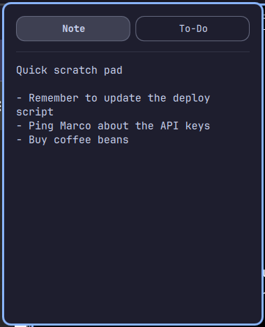

# Fast Note Todo

[](LICENSE)

Fast Note Todo adds a secure multiline scratch note *and* a to-do list to the
Omarchy bar — one icon next to the clock, saving both automatically.



(Screenshots use placeholder example content, not real notes.)

## Credit

This is a fork of [Omanote](https://github.com/brianblakely/omanote) by
Brian Blakely (MIT-licensed) — the note view, its Secret Service storage,
and the panel plumbing are his. The added To-Do tab (add/complete/delete,
drag-to-reorder, inline editing, keyboard navigation with `j`/`k`/`space`/`e`/`x`,
its own storage field) is new here. See [LICENSE](LICENSE) for the original
copyright notice.

## Install

```bash
omarchy plugin add https://github.com/viganogabriele/fast-note-todo.git --enable --yes
```

## Security

Notes and to-dos are stored in the desktop Secret Service rather than
`~/.config/omarchy/shell.json`. Automatic saves use a randomly named file in the
user runtime directory and delete it immediately afterward. The keyring
attribute is still `b.omanote` (the pre-fork plugin id) so a note saved
before the fork stays reachable after upgrading.

Payloads that contain a line break are base64-encoded and tagged with an
`omanote-b64:` marker before they are handed to `secret-tool`, so every
stored secret stays on a single line. A raw plaintext secret containing a
newline would otherwise break gnome-keyring's keyring file format: the daemon
then rejects the whole keyring ("keyring was in an invalid or unrecognized
format"), the keyring reads back empty, and the Secret Service prompts for a
new keyring. A payload without a line break cannot break the file, so it is
stored as it is and keeps its full size. Values without the marker are read
back unchanged, so notes saved by earlier versions stay reachable.

`secret-tool` reads at most 8192 bytes from stdin; above that it stores a
truncated value and still reports success, so the size is checked up front.
A payload of more than 8191 bytes is refused with an error in the panel
instead of being quietly cut short. A payload that has to be encoded — one
with a line break in it — is limited to 6132 bytes of text, because the
encoding takes room as well. The to-do list is trimmed rather than refused:
its oldest completed entries are dropped first, because they are a history
buffer that is pruned anyway.

If the note or the to-do list cannot be read back, the panel says so and
writes nothing: a failed read can no longer be mistaken for an empty note
and overwrite what is still stored in the keyring. While the stored value is
unknown, the note and the to-do list cannot be edited or changed, so there
is no way to write over a value the panel never showed; a save that fails
leaves everything editable, so an oversized note can be shortened and saved
again. A value that simply does not exist yet — a fresh note, or one that
was cleared — is not a failure and is saved as usual.

### If the keyring was already broken

An older version of this plugin could leave the keyring file unparseable, in
which case gnome-keyring drops the whole collection: every entry in it —
including Chrome's and `gh`'s — becomes unreadable, and the panel cannot
tell that apart from an empty keyring. Move the damaged file aside to start
from a clean one, and re-enter the credentials that were in it:

```bash
mv ~/.local/share/keyrings/Default_keyring.keyring{,.broken}
```

A stored note or to-do list that cannot be decoded can be discarded from the
command line:

```bash
secret-tool clear omarchy-plugin b.omanote field note
secret-tool clear omarchy-plugin b.omanote field todos
```

## Update

```bash
omarchy plugin update io.github.viganogabriele.fast-note-todo
```

## Uninstall

```bash
omarchy plugin remove io.github.viganogabriele.fast-note-todo
```
